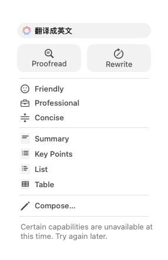

# Apple 智能（Intel）· 非官方本地前端 + 自带 API 后端

在 **Intel Mac（黑苹果 / 老款白苹果）** 上把 Apple 的写作工具面板点亮，并把它的生成请求
接到**你自己的 API**（千问 / OpenAI / OpenRouter / DeepSeek / 本地 LiteLLM、new-api、Ollama……）。

> 这不是 Apple 的软件，也不是「越狱工具」。它不修改任何系统文件，全部逻辑都在
> `/Applications` 里的一个 app 和 `~/Library/Application Support/AppleIntel` 里。
> 卸载 = 删掉这两个东西。



## 它能做什么

| 能力 | 说明 |
| --- | --- |
| Apple 原生写作工具面板 | 真正的 `NSPopoverWindow` + `WritingToolsViewService`，不是仿制 UI |
| 10 个动作全部可用 | Proofread / Rewrite / Friendly / Professional / Concise / Summary / Key Points / List / Table / Compose…（后 8 项原本依赖 Apple 端上模型，这里用「同一面板 + 我们自己发指令」绕过） |
| 自定义指令框 | 面板顶部「Describe your change」里打任意指令（如「翻译成英文」），回车即执行 |
| 全局取词 | 任意 App 里选中文字 → **⌘9** → 面板浮出 → 点动作 → 结果原地写回 |
| 系统服务 | 右键 → 服务 → 直接改写 / 摘要 / 翻译 / 校对选中文字（一行内完成，1 秒级） |
| 撤销 | 菜单栏「撤销上一次改写」，或直接 ⌘Z |
| 结果自动复制 | 改写完成后正文同时进剪贴板 |
| 单窗口主界面 | App Store 式侧边栏：**写作工具**（编辑区 + 面板）/ **快捷操作** / **服务商**（多供应商、预设、连接测试）/ **通用**（登录时打开、自动复制、语言、辅助功能状态）/ **诊断**（自检结果、请求日志） |

## 快速开始（DMG）

1. 双击 `Apple-Intelligence-Intel.dmg`，再双击里面的 App → 点「**安装**」：它会把自己复制到 `/Applications`、
   从那里重新打开并推出磁盘映像（也可以手动拖进 `Applications`）。
2. 如果提示无法验证开发者：**右键 → 打开**（本地 ad-hoc 签名，未做 Apple 公证）。
3. 首次启动会请求「辅助功能」权限：系统设置 → 隐私与安全性 → 辅助功能 → 勾选它。
   > 只用于读取任意 App 里的选中文字和写回结果，不联网上传。
4. 打开 App → 侧边栏「服务商」（或 **⌘,**）→ 填 Base URL / API Key / 模型 → **测试连接** → 保存。
5. 在任意编辑器里选中一段文字，按 **⌘9**。

## 从源码构建

```bash
git clone https://github.com/zheznanohana/nekointelligence.git && cd nekointelligence
./scripts/build.sh                 # 生成 /Applications/…app 和 dist/*.dmg
APP_OUT=/tmp/Test.app NO_DMG=1 ./scripts/build.sh   # 只构建，不打包
```

构建需要：Xcode Command Line Tools（clang）、python3、macOS 15+。
**仓库不包含任何 Apple 二进制**：构建时从本机 `/System/.../WritingToolsViewService.xpc`
复制一份到 app bundle 内，只对这份副本打字节补丁。

## 原理（三句话）

1. Apple 的写作工具由 `WritingToolsUI.framework` 提供给所有 `NSTextView` 应用，但每个进程
   自己判断「本机是否支持生成模型」；Intel 上这个判断恒为 false，所以面板永远是灰的。
2. 我们把系统的 `WritingToolsViewService.xpc` 复制进自己的 app bundle（这样可以用
   `XPCService.EnvironmentVariables.DYLD_INSERT_LIBRARIES` 注入自己的库），打三处字节补丁让
   可用性判定通过，再用一个 `vsstub.dylib` 拦下「ViewService → textcomposerd」的 XPC 代理，
   用我们自己的供应商生成结果。
3. 宿主进程里跑一个 unix socket 中继（`GMBridge`），把 `{system,user}` 变成任意
   OpenAI 兼容的 HTTPS 请求；因此换后端只需要在「服务商」里改一行 Base URL。

## 界面

主窗口是一个标准 `NSSplitViewController`：左侧系统侧边栏（两组：写作 / 设置），右侧内容，
统一工具栏放当前页面的动作（写作工具、撤销改写），每个工具栏动作在菜单栏「写作」里都有对应项；
**⌘1–⌘5** 切换侧边栏项，**⌃⌘S** 显示/隐藏侧边栏。设计按 Apple HIG 审过
（[apple-design skill](https://github.com/dickwu/apple-design-skill)），全部使用语义色，跟随浅色/深色。

源码分布：`src/host/AIHost.m`（宿主、取词、服务、菜单）、`src/host/GMShell.m`（单窗口界面）、
`src/host/GMBridge.m`（中继）、`src/host/GMSetup.m`（自愈安装）、`src/inject/*`（注入 ViewService 的库）。

## 兼容的后端

任何 OpenAI 兼容接口都可以，例如：

- 千问 Token Plan：`https://token-plan.cn-beijing.maas.aliyuncs.com` + `/compatible-mode/v1/chat/completions`
- OpenAI：`https://api.openai.com` + `/v1/chat/completions`
- OpenRouter / DeepSeek / Moonshot / 智谱 …
- 本地网关：**LiteLLM**（:4000）、**new-api / one-api**（:3000）、**Ollama**（:11434）、Bifrost
  —— 管理界面「预设…」里已经内置了这些地址，选一个填 Key 即可。

> 想要「多 API 兼容层」但不想自己写：直接跑 `new-api`（Go 单文件 + SQLite + Web UI）
> 或 `Bifrost`，然后把这里的 Base URL 指过去。本 App 只需要一个 OpenAI 兼容端点。

## 系统要求与限制

- **需要关闭 SIP 与 AMFI**（`csrutil disable` + `amfi_get_out_of_my_way=1`）。原因：整条路线依赖
  `DYLD_INSERT_LIBRARIES` 注入一个带 Apple 私有 entitlements 的 XPC 服务副本。
- **Intel 优先**。Apple Silicon 上 `WritingToolsViewService` 会走 arm64 切片，本仓库的
  三处补丁偏移只针对 x86_64 切片，因此 AS 上大概率仍是灰面板（可以自己用 REA/Ghidra 找偏移）。
- 系统更新可能重建 dyld 共享缓存 / 更新系统组件，补丁偏移需要重新核对；
  `scripts/doctor.sh` 的第一个失败项会告诉你哪里断了。
- 面板底部原本的 Apple 免责文案被替换为 `Powered by Qwen · local bridge (unofficial)`。
- 「设置」按 HIG 本应是独立窗口；这里按「一个窗口」的需求合进了主窗口侧边栏（⌘, 直达「服务商」）。
- Image Playground / 新 Siri / 系统设置里的 Apple 智能面板**不在支持范围**：它们的 UI 跑在
  `arm64e-only` 的 ExtensionKit 扩展里，Intel 无法加载。

## 自检与卸载

```bash
bash ~/Library/Application\ Support/AppleIntel/doctor.sh          # 14 项检查（App 里「诊断」页同样可以跑）
bash ~/Library/Application\ Support/AppleIntel/doctor.sh --fix    # 能修的自动修
bash ~/Library/Application\ Support/AppleIntel/uninstall.sh       # 卸载
```

## 免责声明

- 与 Apple 无关。Apple、Apple Intelligence、Writing Tools 是 Apple Inc. 的商标。
- 仅在你自己的机器上使用；请遵守你所用 API 服务商的条款。
- 本仓库不含 Apple 二进制，也不分发任何密钥。
- 修改系统组件的可用性判定属于非官方行为，系统更新后可能失效。

MIT License.