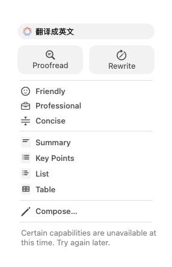
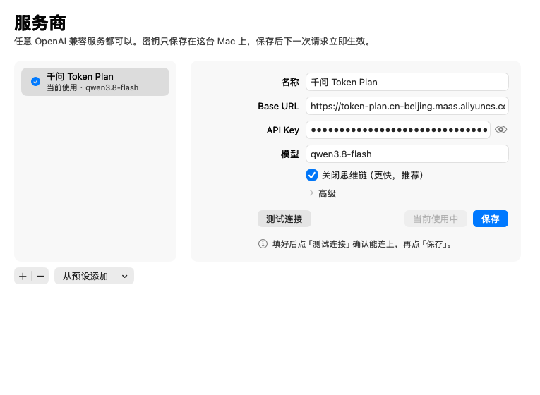
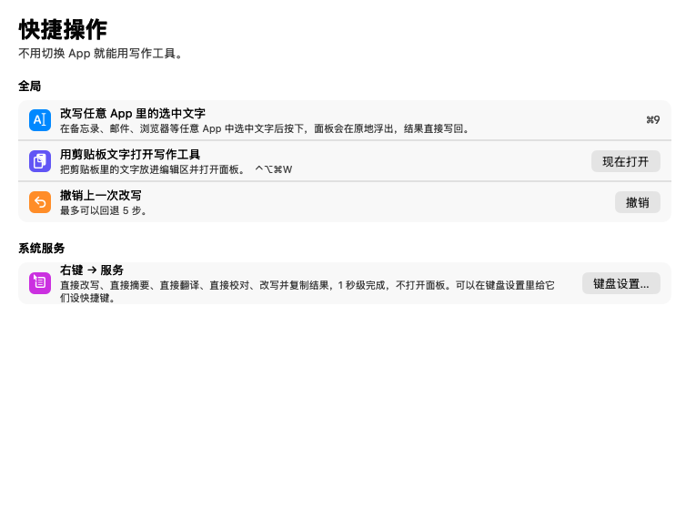

<p align="center">
  
</p>

<h1 align="center">NekoIntelligence</h1>

<p align="center">
  在 Intel Mac 上用上 Apple 原生的<b>写作工具</b>，生成交给<b>你自己的</b> OpenAI 兼容 API。
</p>

<p align="center">
  <a href="https://github.com/zheznanohana/nekointelligence/releases/latest"></a>
  <a href="https://github.com/zheznanohana/nekointelligence/releases"></a>
  
  
  <a href="LICENSE"></a>
</p>

<p align="center">
  <a href="README.md">English</a> · <b>简体中文</b>
</p>

<p align="center">
  
</p>

> [!WARNING]
> NekoIntelligence 需要**关闭 SIP 和 AMFI**。它会加载一份打过补丁、带私有 entitlements 的系统 XPC 服务副本，完整保护状态下的 macOS 会拒绝运行它。请只在你清楚并接受这个代价的机器上使用。

> [!NOTE]
> 这是非官方项目，与 Apple 无关。它**不修改任何系统文件**：全部内容就是 `/Applications` 里的一个 App，加上 `~/Library/Application Support/AppleIntel` 这个目录。

## 功能

- **真正的系统面板，不是仿制品。** 用的是系统自己的 `WritingToolsViewService`（App 内副本 + 三处字节补丁），外观和行为与 Apple 智能完全一致。
- **10 个动作全部可用。** 校对、改写走 Apple 原生链路；友好、专业、简洁、摘要、要点、列表、表格、创作原本依赖 Apple 端上模型，这里改成指令交给你的 API。
- **自定义指令。** 在面板顶部「Describe your change」里输入任意指令，例如「翻译成英文」，回车执行。
- **任意 App 都能用。** 在任何地方选中文字后按 **⌘9**，面板原地浮出，结果直接写回。
- **右键「服务」。** 右键 → 服务 → 直接改写、摘要、翻译或校对，不开面板，1 秒级完成。
- **模型自己选。** 任何 OpenAI 兼容接口都行。内置预设：千问 Token Plan、OpenAI、OpenRouter、DeepSeek、Ollama、LiteLLM、new-api / one-api。
- **原生 Mac 界面。** 一个窗口，App Store 式侧边栏（写作工具、快捷操作、服务商、通用、诊断），按 Apple 人机界面指南设计，自动跟随浅色/深色。
- **可撤销、来源透明。** 可以撤销上一次改写（最多 5 步）；界面上始终标明文字由哪个服务商、哪个模型生成。
- **一键自检。** 「诊断」页一次检查补丁、注入链、服务注册和你的 API。

<p align="center">
  
  
</p>

## 系统要求

| | |
| --- | --- |
| Mac | Intel（x86_64），黑苹果和老款 Intel 白苹果都可以 |
| macOS | 在 macOS 26.7.3 (25G342) 上实测；其他版本可能需要重新找补丁偏移 |
| 安全设置 | 关闭 SIP（`csrutil disable`），关闭 AMFI（boot-args 里加 `amfi_get_out_of_my_way=0x1`） |
| API | 任意 OpenAI 兼容的 chat completions 接口和对应的 API Key |

## 安装

1. 从[最新 Release](https://github.com/zheznanohana/nekointelligence/releases/latest) 下载 `NekoIntelligence-<版本>.dmg`。
2. 打开 DMG，双击里面的 App，点「**安装**」。它会把自己复制到 `/Applications`、从那里重新打开，并推出磁盘映像。也可以手动拖进 Applications。
3. 如果提示无法验证开发者：右键 App →「**打开**」。这个 App 是本地 ad-hoc 签名，没做 Apple 公证。
4. 按提示到 **系统设置 → 隐私与安全性 → 辅助功能** 打开本 App 的开关。它只用来读取你在其他 App 里选中的文字，再把结果写回去。

## 使用

1. 打开 App，进入「**服务商**」（⌘,）。选一个预设，或者填自己的 Base URL、API Key 和模型，点「**测试连接**」，再点「**保存**」。
2. 在任意 App 里选中一段文字，按 **⌘9**。在面板里点一个动作，或者输入指令后回车。
3. 不想开面板时，右键选中的文字 →「**服务**」→「直接改写 / 直接摘要 / 直接翻译 / 直接校对选中文字」。

| 快捷键 | 作用 |
| --- | --- |
| ⌘9 | 改写前台 App 的选中文字 |
| ⌃⌥⌘W | 用剪贴板文字打开写作工具 |
| ⌥⌘Z | 撤销上一次改写 |
| ⌘, | 服务商 |
| ⌘1 – ⌘5 | 切换侧边栏 |
| ⌃⌘S | 显示/隐藏侧边栏 |

默认开机自启，可以在「**通用**」里关掉；界面语言（中文 / English）也在那里切换。

## 常见问题

### 面板是灰的，或者点了动作没反应

打开「**诊断**」，点「**运行自检**」，第一个失败项会告诉你哪里断了。macOS 更新后补丁偏移可能变了，需要针对新版本重新构建。

### 辅助功能已经打开了，App 里还是「未授权」

macOS 按 App 的代码签名记录辅助功能授权，而旧副本和新副本的 bundle ID 是同一个。清掉这条记录再授权一次：

```bash
tccutil reset Accessibility com.local.appleintelligence.intel
```

然后重新打开 App，按提示再打开一次开关。

### 为什么要关 SIP 和 AMFI？

面板来自 Apple `WritingToolsViewService` 的一份副本。这份副本是 ad-hoc 签名，却需要 Apple 的私有 entitlements，而且要用 `DYLD_INSERT_LIBRARIES` 注入我们的库，这两件事都会被 AMFI 拦下。要注意，关掉 AMFI 也会让整个系统少一道重要的安全防护。

### Apple Silicon 能用吗？

大概率不行。三处补丁偏移只针对 x86_64 切片，你可以自己用 Ghidra 之类的工具去找 arm64 的对应位置。

### 支持 Image Playground、新 Siri、系统设置里的 Apple 智能面板吗？

不支持。它们的界面跑在 arm64e-only 的扩展里，Intel 无法加载。

### API Key 存在哪里？

存在 `~/Library/Application Support/AppleIntel/providers.json`，权限 `0600`，只在你的 Mac 上，暂时还没有放进钥匙串。

## 卸载

```bash
bash ~/Library/Application\ Support/AppleIntel/uninstall.sh
```

会删除 App、开机自启项、支持目录、服务注册和临时文件。加 `--keep-data` 保留配置和日志，加 `--check` 只查看装了什么、不删除。

## 从源码构建

需要 Xcode Command Line Tools（`clang`）、`python3`、macOS 15 或更高版本。

```bash
git clone https://github.com/zheznanohana/nekointelligence.git && cd nekointelligence
./scripts/build.sh                                    # 安装到 /Applications 并生成 dist/*.dmg
APP_OUT=/tmp/Test.app NO_DMG=1 ./scripts/build.sh     # 只构建，不打包
```

仓库里**不含任何 Apple 二进制**。构建时会从你本机系统复制 `WritingToolsViewService.xpc`，只给这份副本打补丁。

## 原理

1. `WritingToolsUI.framework` 给所有 `NSTextView` App 提供写作工具，但每个进程会先判断本机是否支持生成模型。在 Intel 上这个判断永远是否，所以面板一直是灰的。
2. NekoIntelligence 把系统的 `WritingToolsViewService.xpc` 复制进自己的 bundle，这样就能通过 `XPCService.EnvironmentVariables.DYLD_INSERT_LIBRARIES` 注入库。三处字节补丁让可用性判定通过，`vsstub.dylib` 拦下 ViewService → `textcomposerd` 的 XPC 代理，改由你的服务商回答。
3. 宿主 App 里有一个 unix socket 中继（`GMBridge`），把 `{system, user}` 转成 OpenAI 兼容的 HTTPS 请求。换后端只需要改一个 Base URL。

| 路径 | 内容 |
| --- | --- |
| `src/host/AIHost.m` | 宿主：取词、系统服务、菜单、快捷键 |
| `src/host/GMShell.m` | 单窗口界面 |
| `src/host/GMBridge.m` | 到你的 API 的中继 |
| `src/host/GMSetup.m` | 自愈、自安装、开机自启 |
| `src/inject/` | 注入 ViewService 的库 |
| `scripts/` | 构建、补丁、自检、卸载脚本 |

## 已知限制

- 补丁偏移只在 macOS 26.7.3 (25G342) 上核对过。
- 在面板里输入的指令和 8 个预设动作，要等上游返回后才写入（实测 10–20 秒），不支持流式输出。
- API Key 存在文件里，还没进钥匙串。
- ⌘9 暂时不能改。
- 英文界面不完整，部分提示仍是中文。

## 致谢

- 界面使用 [apple-design-skill](https://github.com/dickwu/apple-design-skill) 审查，这是一个基于 Apple 人机界面指南的设计审查工具。

## 许可证

[MIT](LICENSE)。Apple、Apple Intelligence、Writing Tools 是 Apple Inc. 的商标。请只在你自己的 Mac 上使用，并遵守你所用 API 服务商的条款。
